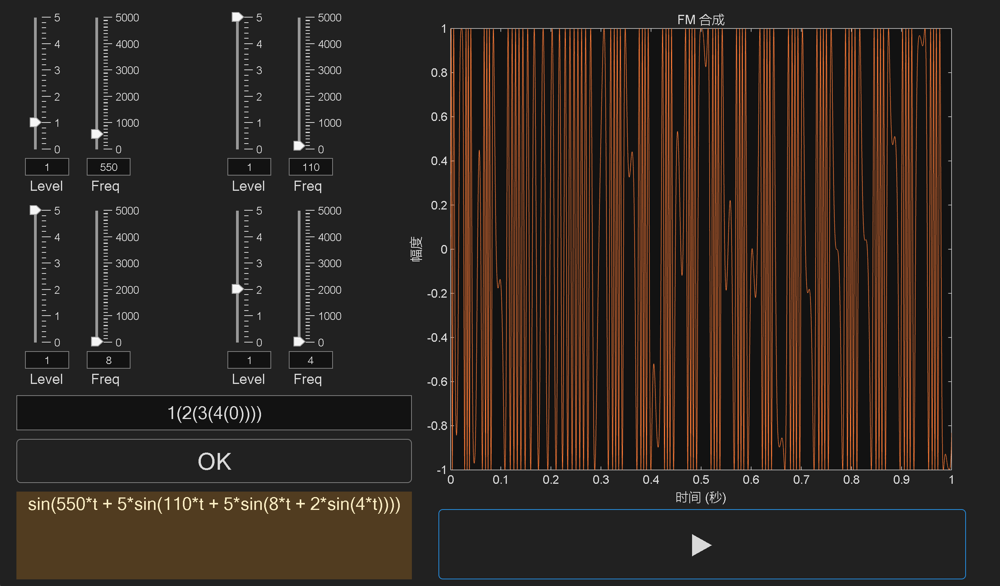
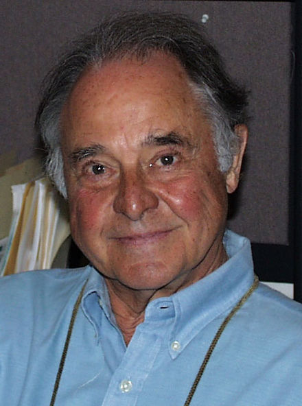
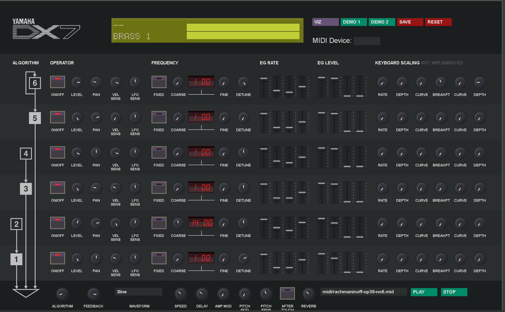
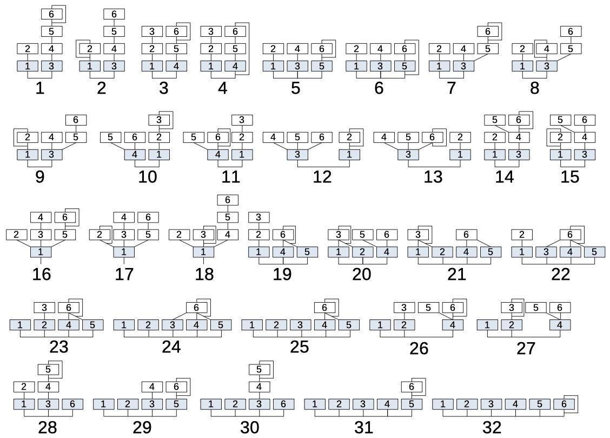

# synthesizer

> 🧸 **old toy** —— 2021 年前后 MATLAB 课程的结课作业，**不再维护**，仅作存档。
> Archived coursework. Not maintained. Kept for the write-up, not the code.

基于 FM 合成原理、用 MATLAB 实现的声音合成器，默认 4 个振荡器。

原仓库：[`77-223255/synthesizer`](https://github.com/77-223255/synthesizer)（已并入本仓库）



## 目的

1. 熟悉 FM 合成的基本原理
2. 实现振荡器与调制器的**任意**算法组合 —— Yamaha DX7 / DX9 分别只有 32 / 8 种固定算法，且不能控制振荡器与调制器总数

## 依赖

| 依赖 | 说明 |
| --- | --- |
| **MATLAB** | 在 R2021 附近版本上写的；新版未验证 |
| **Symbolic Math Toolbox** | `FM_synthesizer.m` 用 `syms t` 做符号表达式，`subs` 代入求值 —— 这是唯一的工具箱依赖 |

`sound` / `audioplayer` / `figure` / `uicontrol` 都是 MATLAB 基础功能，不需要额外工具箱。

## 运行

1. 把 `FM_synthesizer.m` 和 `FMSynthesizerGUI.m` 放到同一目录，并加入 MATLAB 执行路径
2. **改一行**：`FMSynthesizerGUI.m` 第 4 行是占位符，必须换成实际路径

```matlab
addpath('path_to_FM_synthesizer_folder');   % ← 换成脚本所在目录
```

3. 运行 `FMSynthesizerGUI.m`

## FM 原理

FM 源于广播：天线长度有限，不能直接收发低频信号，于是用高频信号的**频率**变化去承载低频信号的强弱，这样天线就能把「转化」后的信号收到，收音机再还原成声音。

低频那一端叫**调制波**，被调制的那一端叫**载波**。写成公式（都假设为正弦波）：

```
y = A · sin(w·t + A' · sin(w'·t))
```

FM 合成器的基本原理就是这样。至于 FM 如何调制出无穷的音色，见 Chowning 论文里关于负频率与贝塞尔函数的讨论。

> *The Synthesis of Complex Audio Spectra by Means of Frequency Modulation* — John M. Chowning

值得一提的是，Chowning 在 1967 年发明了这项技术，他本人还是一位作曲家。



### YAMAHA 的创新

Chowning 于 1973 年把这项技术授权给 Yamaha；1983 年 Yamaha 推出 DX7。

- DX7 网页复刻：<https://mmontag.github.io/dx7-synth-js/>



除了沿用已有的 ADSR 包络与 Chowning 的 FM 技术，Yamaha 还提供了振荡器与调制器排列组合的 32 种算法，音色因此丰富得多。



## 代码分析

### `FM_synthesizer.m`

1. 定义振荡器的基本属性：`Level`、`Frequency`
2. `generatewave` 用符号表达式生成波形

### `FMSynthesizerGUI.m`

1. 绘制软件界面
2. `change` 把文本转成算法表达式 —— 基本思路是递归，配合 `generatewave` 就能实现任意算法设计

   例如 `1(2(3(3(0))))+4(0)` 表示下面这个连接方式：

   )))+4(0).png)

3. `generateWaveformData` 把 `change` 生成的表达式转成具体音频信号
4. 各按钮与输入框的回调

### 可调参数

| 参数 | 说明 |
| --- | --- |
| 采样率 `Fs` | 受代码性能限制，初始 16000 次/秒 |
| 播放时长 / 间隔 | `generateWaveformData` 其实能接受完整一个信号周期，但受性能限制取 1 s；间隔随时长调整 |
| 振荡器数量 | 默认 4 个。要改需增删对应 UI 控件、类实体，并在 `playButtonCallback` 里增删实体数据更新代码 |

## 缺陷

1. 代码运行效率过低
2. 缺少 ADSR 包络与 MIDI 信号输入
3. 振荡器目前只能输出正弦波

## 参考

1. John M. Chowning, *The Synthesis of Complex Audio Spectra by Means of Frequency Modulation*
2. John Chowning & David Bristow, *FM Theory & Applications — By Musicians for Musicians*
3. <https://yamahadx9.com/index.html>
4. <https://mmontag.github.io/dx7-synth-js/>

## 仓库贡献

- 这是存档项目，**不打算继续维护**；发现问题可以提 issue，但不要期待修复。
- 如果哪天真要动它：MATLAB 代码保持两个文件的结构，`image/` 里是 README 引用的图片，改文件名记得同步改 README。
- Commit message 用英文 conventional 风格（`feat:` / `fix:` / `docs:`）。
- 依赖栏里唯一需要留意的是 **Symbolic Math Toolbox** —— 想摆脱它就得把 `syms` 那套改写成数值实现。

## License

未声明。
